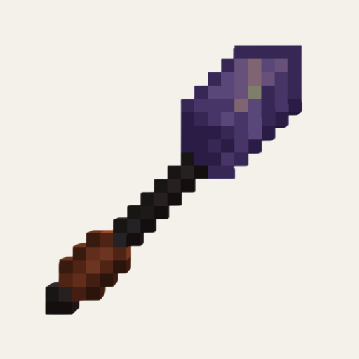

<p align="center"></p>

<h1 align="center">🪄 Purple Stick</h1>

<p align="center"><b>The ultimate builder's wand for placing and destroying blocks effortlessly.</b></p>

<p align="center">
  
  
  
  
  
  <a href="https://github.com/tariksharabaty/o-lib"></a>
  <a href="https://modrinth.com/organization/oidioomstudio"></a>
  <a href="https://oidioom.com"></a>
</p>

<p align="center"><a href="#-english">🇬🇧 English</a> · <a href="#-türkçe">🇹🇷 Türkçe</a></p>

---

## 🇬🇧 English

> [!IMPORTANT]
> Requires **[O Lib](https://github.com/tariksharabaty/o-lib)** and **Fabric API**.

**Purple Stick** gives builders and terraformers unmatched speed and precision. Place entire walls, bridges, and floors in an instant, or clear out unwanted terrain and obstacles with a flick of your wrist. Built on modern Minecraft 26.x Typed Data Components for maximum stability and speed.

---

## ✨ Key Features

- 🏗️ **Dual Operational Modes:**
  - **Build Mode (Green Highlight):** Expands the targeted surface with blocks from your inventory or offhand.
  - **Destruction Mode (Red Highlight):** Instantly clears matching connected blocks.
- 🔒 **Geometric Locks (Mode Constraints):**
  - **Area Locks:** 1x1, 3x3, 5x5, and up to 9x9 (81 blocks at once!).
  - **Directional Locks:** Horizontal, Vertical, North-South, East-West.
- 🎋 **5 Balanced Material Tiers:**
  - **Wooden Stick:** 16 block limit (128 durability)
  - **Copper Stick:** 64 block limit (256 durability)
  - **Iron Stick:** 256 block limit (512 durability)
  - **Diamond Stick:** 512 block limit (2048 durability)
  - **Netherite Stick:** 1024 block limit (4096 durability, fire resistant)
- 🧰 **Off-Hand Block Selection:** Hold a block in your offhand to place that specific block type instead of the clicked surface!
- 🎨 **Live Outline Preview:** Highlights exactly which blocks will be modified in real-time.
- ⚡ **Modern 26.x Data Components:** Utilizes typed `DataComponentType<StickMode>` and `DataComponentType<StickLock>` — zero legacy NBT lag!

---

## 🎮 Controls

- **Sneak + Right-Click (in air):** Opens the GUI to choose Mode (Build / Destruction) and Lock type.
- **Right-Click (on block):** Executes placement or destruction along the selected face.

---

## 📥 Installation

1. Install **Minecraft 26.3** with **Fabric Loader**.
2. Install **Fabric API**.
3. Install **O Lib** (required core library).
4. Drop `purple-stick-1.1.2-mc26.3.jar` into your `mods` folder.

---

## ⬇️ Download

- **Modrinth:** [Oidioom Studio](https://modrinth.com/organization/oidioomstudio)
- **GitHub Releases:** [`purple-stick-1.1.2-mc26.3.jar`](../../releases/latest)

## 🔨 Building from source

Requires **JDK 25**.

```bash
# 1) O Lib is a dependency — publish it to your local Maven first
git clone https://github.com/tariksharabaty/o-lib.git
(cd o-lib && ./gradlew publishToMavenLocal)

# 2) build this mod
./gradlew build
# output: build/libs/purple-stick-1.1.2-mc26.3.jar
```

## 📄 License

[MIT](LICENSE) © 2026 Oidioom / Tarek Sharabaty

---

## 🇹🇷 Türkçe

**Akıcı yerleştirme ve hassas geometrik kilitlerle nihai inşa ve yıkım asası.**

> [!IMPORTANT]
> **[O Lib](https://github.com/tariksharabaty/o-lib)** ve **Fabric API** gerektirir.

### ✨ Özellikler

- İkili mod: yerleştirme ve yıkım
- Geometrik kilitler (eksen ve düzlem sınırlamaları)
- 5 dengeli malzeme kademesi
- Sol eldeki bloğu yerleştirme
- Canlı ön izleme çerçevesi, modern 26.x Data Components

### 📥 Kurulum

1. **Minecraft 26.3** için **Fabric Loader** kurun.
2. **Fabric API** ve **O Lib** modlarını `mods` klasörüne ekleyin.
3. `purple-stick-1.1.2-mc26.3.jar` dosyasını `mods` klasörüne atın ve oyunu başlatın.

### ⬇️ İndir

- **Modrinth:** [Oidioom Studio](https://modrinth.com/organization/oidioomstudio)
- **GitHub Releases:** [`purple-stick-1.1.2-mc26.3.jar`](../../releases/latest)

### 📄 Lisans

[MIT](LICENSE) © 2026 Oidioom / Tarek Sharabaty

---

<p align="center"><a href="https://oidioom.com"></a></p>
<p align="center"><b>by Oidioom — Tarek Sharabaty</b><br>
<a href="https://oidioom.com">oidioom.com</a> · <a href="https://github.com/tariksharabaty">GitHub</a> · <a href="https://modrinth.com/organization/oidioomstudio">Modrinth</a> · <a href="https://gear.oidioom.com">Gear</a> · <a href="https://www.instagram.com/oidioom">Instagram</a></p>
